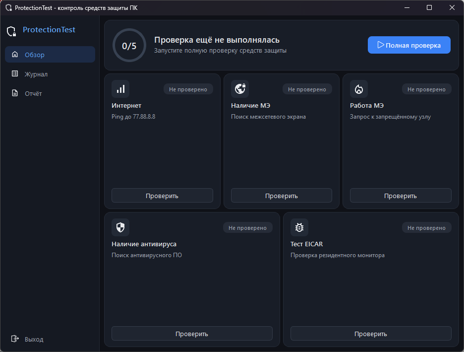

# ProtectionTest

**Курсовая работа по дисциплине "МОБКС"**

Программа для проверки работоспособности средств защиты компьютера: подключения к Интернету, межсетевого экрана и антивирусного программного обеспечения.

---
## Технологии и требования

- Среда разработки: **Qt Creator/Visual Studio Code**
- Операционная система: **Windows 10/11**
- Язык программирования: **C++**
- Фреймворк: **Qt6** (Widgets, Network)
- Система сборки: **CMake**
- Системные API: **COM** (`INetFwPolicy2`), **WMI** (`root\SecurityCenter2`), **Service Control Manager**
---

## **Функциональность**
### Проверки
1. Проверка подключения к Интернету
   - TCP-подключение к DNS-серверу `77.88.8.8:53` с таймаутом 3 секунды
2. Проверка наличия межсетевого экрана
   - Поиск сторонних МЭ через Центр безопасности Windows (`FirewallProduct`)
   - Проверка состояния брандмауэра Windows для активных сетевых профилей через `INetFwPolicy2`
3. Проверка работоспособности межсетевого экрана
   - Предполагается, что в брандмауэре Windows заранее создано правило «ProtectionTest Block», запрещающее исходящие соединения с 1.1.1.1:80.
   - Программа пытается подключиться к этому узлу: если соединение заблокировано — правило соблюдается и МЭ работает.
4. Проверка наличия антивирусного ПО
   - Поиск антивирусов через Центр безопасности Windows (`AntiVirusProduct`)
   - Определение состояния защиты и актуальности баз, отсеивание дубликатов и удалённых продуктов
5. Проверка работоспособности антивирусного ПО
   - Создание тестового файла **EICAR** и ожидание реакции резидентного монитора (до 15 секунд)

### Интерфейс
1. Главный экран с общим статусом защиты и карточками проверок.
2. Запуск каждой проверки отдельно или полной проверки по очереди.
3. Журнал событий с отметками времени.
4. Формирование отчёта с итогом, результатами проверок и рекомендациями.
5. Сохранение отчёта в формате `.md`.

---

## Структура проекта

- `include/` — заголовочные файлы
- `src/` — исходный код
  - `mainwindow.cpp`, `mainslots.cpp` — главное окно и слоты проверок
  - `securitycenter.cpp` — запросы к Центру безопасности Windows через WMI
  - `util.cpp` — работа с брандмауэром Windows и службами
  - `report.cpp` — полная проверка и формирование отчёта
- `ui/` — макет главного окна
- `resources/` — иконки и ресурсы приложения